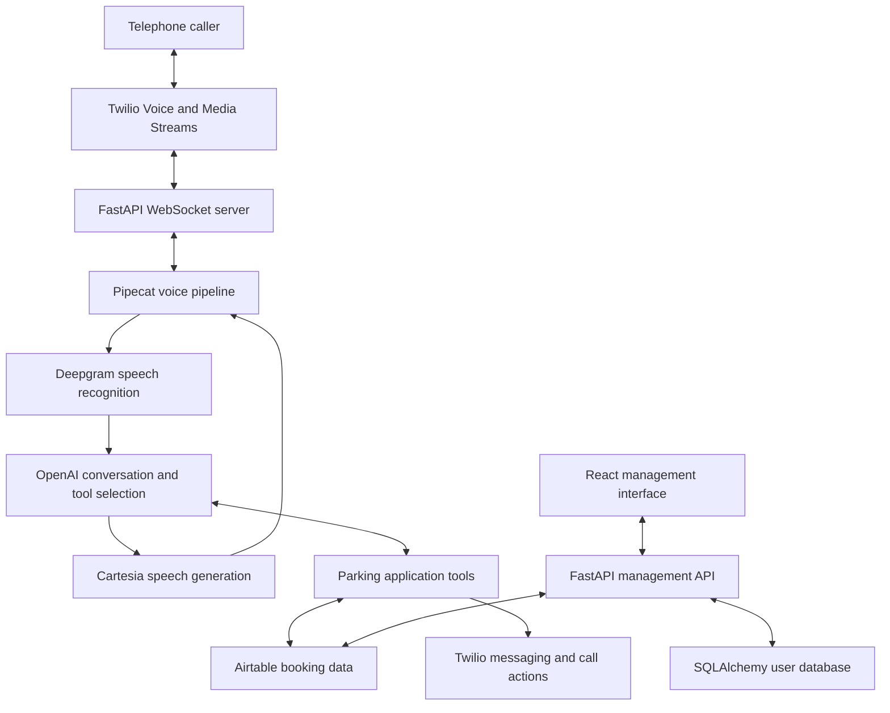

# CallAI Parking

### An AI voice agent for airport parking customer support

CallAI Parking is a Python application I built on top of the Pipecat framework to handle telephone conversations for an airport parking use case. It connects live speech processing with booking tools, allowing the agent to look up bookings, update selected details and coordinate customer requests.

I developed the application and its integrations personally, adapting the conversation flow and testing it through real spoken conversations to make the interaction feel natural. Pipecat provides the underlying voice-agent framework; the parking workflow and application integration are my project work.

**Project status:** Historical prototype, currently not deployed. The voice integration targets an older Pipecat API and needs a dependency and compatibility refresh before reuse. Current functionality has not been revalidated against today's service APIs.

## The problem

Airport parking calls combine conversation with operational tasks: identifying a booking, clarifying vehicle details, confirming a terminal or arrival time, and notifying staff. A useful agent needs to connect spoken requests to the correct application action while keeping the conversation understandable.

This project explores that workflow through an integrated voice agent and a supporting management interface.

## Implemented capabilities

| Area | Implementation in this repository |
| --- | --- |
| Telephone integration | Twilio call handling and WebSocket audio transport |
| Voice pipeline | Pipecat orchestration, Deepgram speech recognition, OpenAI model integration and Cartesia speech generation |
| Booking lookup | Lookup tools using vehicle registration, telephone number or booking reference |
| Booking updates | Tools for updating contact numbers, terminal, arrival time and vehicle details |
| Staff coordination | WhatsApp notification functions and transfer to a human contact |
| Management interface | React interface and FastAPI backend for bookings, users and bot configuration |
| Persistence | SQLAlchemy models and database initialisation code |
| Conversation records | Transcript capture, call recording integration and application logging |

These describe implemented code paths. Their current end-to-end operation needs fresh verification after the dependency update.

## Architecture

## My contribution

- Built the application on top of Pipecat and connected the telephone, speech and language-model services.
- Implemented parking-specific tool integrations for booking lookups, updates, notifications and call handling.
- Built the supporting management interface and backend.
- Adapted the agent's instructions and conversation behaviour, then tested it through real spoken conversations.
- Added custom Pipecat-related processors and application code for transcript handling and conversation behaviour.

Testing focused on making conversations and application interactions feel realistic. This repository does not currently provide a published benchmark for latency, task success, customer satisfaction or security effectiveness.

## Repository guide

| Path | Purpose |
| --- | --- |
| `server.py` | Telephone webhook and WebSocket entry points |
| `bot.py` | Voice pipeline, conversation context and tool registration |
| `functions/` | Parking workflows and external service operations |
| `custom_pipecat/` | Custom processors, service adaptations and recording helpers |
| `params.json` | Conversation instructions and application parameters |
| `web-ui/src/` | React management interface |
| `web-ui/backend/` | Management API, authentication and database code |
| `test-functions.py` | Manual function integration test script |
| `Dockerfile`, `fly.toml`, `docker-compose.yml` | Historical build and deployment configuration |

## Conversation design and testing

The project required more than connecting service APIs. I worked on how the agent moves between conversation and actions, responds during a lookup, handles clarification and hands a request to a human.

The repository includes tool definitions, conversation instructions, interruption-related code, idle handling and transcript capture. Some processors are experimental or disabled in the current pipeline; their presence does not mean every feature is active.

Real spoken testing informed the application's behaviour. This README makes no claim of commercial operating results.

## Running and testing

The current checkout requires maintenance before it can be treated as a reproducible demonstration:

1. Select a compatible Python and Pipecat version, update changed APIs and lock the dependency set.
2. Replace external booking and messaging integrations with synthetic fixtures or mocks for the first local run.
3. Configure local secrets privately and provision an administrator explicitly.
4. Validate the management backend, frontend and booking tools separately before enabling the voice pipeline.
5. Reconcile the container configuration: the current Compose file references `Dockerfile.backend` and `Dockerfile.ai`, which are not included in this checkout.
6. Run automated tests against isolated test data, then validate speech interaction using test service accounts.

The supplied integration scripts can change booking records or send messages when real credentials are configured. Review them and isolate their dependencies before running them. Existing tests are development assets, not evidence that the current application passes a clean automated test run.

## AI security development plan

My next goal is to turn this application into a documented AI-agent security engineering project. The following are planned improvements, not completed controls:

- Threat-model the caller, model, application tools, booking data and management interface.
- Validate inbound telephone requests and WebSocket connections.
- Bind permitted booking and call actions to verified backend session context.
- Enforce authorisation in application tools independently of model instructions.
- Remove credential exposure through logs and configuration responses, and require secure secret provisioning.
- Introduce data minimisation, redaction and explicit handling of recordings and transcripts.
- Add call-duration, concurrency and tool-use limits.
- Build repeatable tests for prompt injection, cross-booking access and unauthorised tool calls, alongside legitimate-use tests.
- Publish the assessment, remediation changes, test results and remaining limitations.

The central question is whether the application prevents an unauthorised action even when a model proposes it.

## Technology

Python, Pipecat, FastAPI, WebSockets, Twilio, Deepgram, OpenAI, Cartesia, Airtable, React, SQLAlchemy and Docker. Historical deployment configuration is included for Fly.io.

## Attribution and licence

Built on the [Pipecat framework](https://github.com/pipecat-ai/pipecat). External services and dependencies retain their respective terms and licences.

This repository includes a [BSD 2-Clause licence](LICENSE).
